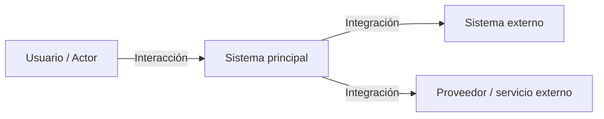
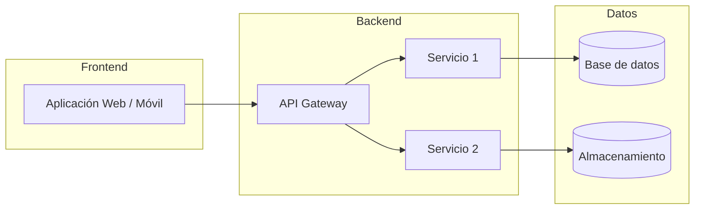

# Plantilla de Descripción del Sistema

## 1. Información General

- Nombre del sistema: [Nombre del sistema]
- Versión: [Versión]
- Fecha: [YYYY-MM-DD]
- Responsable: [Nombre / equipo]
- Estado: [En desarrollo / En producción / En evolución]

## 2. Propósito del Sistema

El sistema [Nombre del sistema] tiene como objetivo [describir el propósito principal, valor para el usuario y problema que resuelve].

### Objetivos del negocio
- [Objetivo 1]
- [Objetivo 2]
- [Objetivo 3]

### Usuarios y actores
- [Actor 1]: [Rol y descripción]
- [Actor 2]: [Rol y descripción]
- [Actor 3]: [Rol y descripción]

## 3. Alcance

### Incluye
- [Funcionalidad 1]
- [Funcionalidad 2]
- [Funcionalidad 3]

### Excluye
- [Funcionalidad no incluida]
- [Integración no contemplada]
- [Casos fuera del alcance]

## 4. Contexto del Sistema

### Diagrama de contexto (Archimate - Nivel 1)



### Actores principales
| Actor           | Rol   | Relación con el sistema |
|-----------------|-------|-------------------------|
| [Actor]         | [Rol] | [Descripción]           |
| [Actor externo] | [Rol] | [Descripción]           |

### Sistemas externos
| Sistema           | Tipo                            | Función |
|-------------------|---------------------------------|---------|
| [Sistema externo] | [API, servicio, gobierno, nube] | [Rol]   |

## 5. Arquitectura del Sistema

### Diagrama de contenedores (Archimate - Nivel 2)



### Componentes principales
```
catalogo_sistemas_plantilla.csv
```

| Componente     | Función   | Tecnología sugerida |
|----------------|-----------|---------------------|
| [Componente 1] | [Función] | [Tecnología]        |
| [Componente 2] | [Función] | [Tecnología]        |
| [Componente 3] | [Función] | [Tecnología]        |

## 6. Flujos Clave de Negocio
```
matriz_flujos_datos_plantilla.csv
```

### Flujo 1: [Nombre del flujo]
1. [Paso 1]
2. [Paso 2]
3. [Paso 3]
4. [Resultado esperado]

### Flujo 2: [Nombre del flujo]
1. [Paso 1]
2. [Paso 2]
3. [Paso 3]
4. [Resultado esperado]

## 7. Requisitos de Integración

### API internas
- [Servicio A] → [Servicio B]: [tipo de comunicación]
- [Servicio B] → [Servicio C]: [tipo de comunicación]

### Integraciones externas
- [Sistema externo] → [Propósito]
- [Sistema externo] → [Propósito]

### Protocolos
- HTTP/REST
- HTTPS
- AMQP / Kafka / RabbitMQ
- SQL / NoSQL
- OAuth 2.0 / JWT / MFA

## 8. Modelo de Datos

### Entidades principales
```
catalogo_datos_plantilla_puntoycoma.csv
```

| Entidad     | Descripción   | Atributos clave    |
|-------------|---------------|--------------------|
| [Entidad 1] | [Descripción] | [Campo 1, Campo 2] |
| [Entidad 2] | [Descripción] | [Campo 1, Campo 2] |

### Consideraciones de persistencia
- [Persistencia principal]
- [Datos sensibles]
- [Retención y auditoría]

## 9. Seguridad

### Requisitos de seguridad
- Autenticación: [JWT / OAuth / MFA]
- Autorización: [RBAC / ABAC / roles]
- Cifrado: [TLS, cifrado de datos]
- Auditoría: [registros, trazabilidad]
- Protección: [WAF, rate limiting, DDOS]

## 10. Consideraciones no funcionales

### Rendimiento
- [Tiempo de respuesta esperado]
- [Picos esperados de carga]

### Disponibilidad
- [Objetivo de disponibilidad]
- [Tolerancia a fallos]

### Escalabilidad
- [Horizontales / verticales]
- [Criterios de crecimiento]

### Mantenibilidad
- [Separación por servicios]
- [Pruebas y despliegue]

## 11. Decisiones de Arquitectura

### Patrones aplicados
- [Patrón 1]: [Descripción]
- [Patrón 2]: [Descripción]
- [Patrón 3]: [Descripción]

### Restricciones
- [Restricción 1]
- [Restricción 2]
- [Restricción 3]

## 12. Riesgos y Suposiciones

### Riesgos
- [Riesgo 1]
- [Riesgo 2]

### Suposiciones
- [Suposición 1]
- [Suposición 2]

## 13. Anexos

### Glossario
- [Término 1]: [Definición]
- [Término 2]: [Definición]

### Referencias
- [Documento / estándar / guía / enlace externo]

---

## Plantilla de Descripción

### Resumen
[Se redacta una descripción breve del sistema, propósito, alcance y valor para el negocio.]

### Titular
[El sistema permite a los usuarios ... mediante ...]
