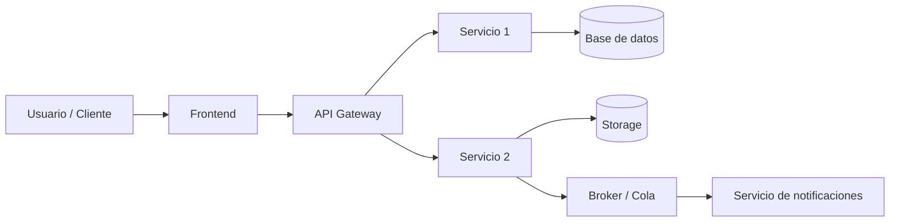

# Plantilla de Requisitos para el Despliegue

## 1. Información del Documento

- Proyecto: [Nombre del proyecto]
- Versión: [Versión]
- Fecha: [YYYY-MM-DD]
- Responsable: [Nombre / equipo]
- Estado: [Borrador / Aprobado / En revisión]

## 2. Objetivo

Este documento define los requisitos necesarios para desplegar [Nombre del sistema] en el entorno de ejecución seleccionado, incluyendo infraestructura, dependencias, seguridad, configuración, operación y validación.

## 3. Alcance del Despliegue

### Entorno objetivo
- [Entorno 1: desarrollo]
- [Entorno 2: pruebas]
- [Entorno 3: producción]

### Componentes a desplegar
- [Frontend / UI]
- [API gateway]
- [Microservicios]
- [Broker / mensajería]
- [Bases de datos]
- [Storage / blob / object storage]
- [Servidores externos]

## 4. Requisitos de Infraestructura

### Infraestructura base
| Requisito | Detalle |
|---|---|
| Plataforma | [Kubernetes / Docker / VM / Cloud] |
| Cluster / entorno | [Nombre o detalle] |
| Namespace | [nombre] |
| Region / zona | [Región / zona / disponibilidad] |
| Red | [VPC / subred / red privada / pública] |

### Recursos mínimos
| Componente | CPU | Memoria | Disco | Observaciones |
|---|---|---|---|---|
| [Servicio] | [x vCPU] | [x GiB] | [x GiB] | [Detalle] |
| [Base de datos] | [x vCPU] | [x GiB] | [x GiB] | [Detalle] |
| [Broker] | [x vCPU] | [x GiB] | [x GiB] | [Detalle] |

### Requisitos de alta disponibilidad
- [Número de réplicas]
- [Balanceador / ingress]
- [Persistencia por componente]
- [Tolerancia a fallos]

## 5. Requisitos de Software y Dependencias

### Runtime / Framework
| Componente | Tecnología | Versión |
|---|---|---|
| [Servicio] | [Java / Go / Python / Node] | [Versión] |
| [Frontend] | [React / Angular / Vue] | [Versión] |
| [Base de datos] | [PostgreSQL / MySQL / DynamoDB / MongoDB] | [Versión] |

### Dependencias externas
- [Servicio externo 1]: [propósito]
- [Servicio externo 2]: [propósito]
- [Proveedor de correo / notificaciones]
- [Almacén de objetos / cloud storage]

## 6. Topología de Despliegue

### Diagrama de despliegue

### Descripción
- [Frontend]: [detalle]
- [API Gateway]: [detalle]
- [Microservicios]: [detalle]
- [Base de datos]: [detalle]
- [Storage]: [detalle]
- [Broker]: [detalle]

## 7. Requisitos de Red

### Puertos
| Componente | Puerto | Protocolo | Uso |
|---|---|---|---|
| [Frontend] | [80 / 443 / 8080] | [HTTP / HTTPS] | [Uso] |
| [API Gateway] | [8080] | [HTTP / HTTPS] | [Uso] |
| [Servicio A] | [8080] | [HTTP] | [Uso] |
| [Base de datos] | [5432] | [SQL] | [Uso] |
| [Broker] | [5672 / 15672] | [AMQP / HTTP] | [Uso] |

### Reglas de acceso
- [Permitir tráfico desde X hacia Y]
- [Bloquear acceso directo a la base de datos]
- [Exponer solo endpoints autorizados]

## 8. Requisitos de Seguridad

### Seguridad operativa
- Autenticación de usuarios: [JWT / OAuth 2.0 / MFA]
- Autorización: [RBAC / roles / políticas]
- Cifrado en tránsito: [TLS 1.2+]
- Cifrado en reposo: [AES / cifrado nativo de la base de datos]
- Gestión de secretos: [Vault / Kubernetes Secrets / Variables de entorno]

### Requisitos de cumplimiento
- [Cumplimiento 1]
- [Cumplimiento 2]
- [Auditoría de accesos]

## 9. Persistencia y Datos

### Bases de datos
| Base de datos | Tipo | Volumen estimado | Persistencia |
|---|---|---|---|
| [DB 1] | [SQL / NoSQL] | [GB / TB] | [Sí / No] |
| [DB 2] | [SQL / NoSQL] | [GB / TB] | [Sí / No] |

### Sistemas de almacenamiento
- [Bucket / blob / almacenamiento de archivos]
- [Retención de backups]
- [RPO / RTO objetivo]

### Backups y restauración
- Frecuencia: [diaria / semanal / manual]
- Retención: [7 días / 30 días / 90 días]
- Método: [snapshot / export / backup automatizado]

## 10. Observabilidad y Operación

### Monitoreo
- [Métricas de infraestructura]
- [Métricas de aplicaciones]
- [Trazabilidad distribuida]
- [Alertas por umbral]

### Logs
- Formato: [JSON / texto]
- Retención: [X días]
- Centralización: [ELK / Splunk / Loki / CloudWatch]

### Health checks
- [Endpoint / readiness / liveness]
- [Frecuencia de revisión]
- [Acciones en fallo]

## 11. Configuración y Variables de Entorno

| Variable | Descripción | Requerida |
|---|---|---|
| [NOMBRE_ENV] | [Descripción] | Sí |
| [DB_HOST] | [Host de la base de datos] | Sí |
| [API_KEY] | [Clave de integración] | Sí |
| [JWT_SECRET] | [Secreto de JWT] | Sí |

### Reglas
- [No guardar secretos en repositorio]
- [Usar variables del entorno o secret manager]
- [Definir valores por entorno]

## 12. Requisitos de Despliegue y CI/CD

### Flujo de despliegue
1. [Build del código]
2. [Validación automática]
3. [Escaneo de seguridad]
4. [Empaque de artefactos]
5. [Despliegue a entorno]
6. [Verificación funcional]

### Criterios de aprobación
- [Pruebas unitarias / de integración]
- [Health check OK]
- [Validación manual del negocio]
- [Sin alertas críticas]

## 13. Capacidad y Escalado

### Carga esperada
- [Usuarios concurrentes]
- [Volumen transaccional diario]
- [Tamaño de archivos / volumen de documentos]

### Estrategia de escalado
- [Escalado horizontal por microservicio]
- [Autoescalado de infraestructura]
- [Ajuste de volumen de almacenamiento]

## 14. Requisitos de Recuperación ante Desastres

### Objetivos
- RTO: [horas / minutos]
- RPO: [horas / minutos]

### Procedimiento
- [Backup regular]
- [Restauración de entorno]
- [Validación post-recuperación]

## 15. Validación del Despliegue

### Checklist de aceptación
- [ ] El sistema inicia correctamente
- [ ] Los servicios responden a health checks
- [ ] La conexión a la base de datos está operativa
- [ ] Las integraciones externas responden
- [ ] Se verifican permisos y credenciales
- [ ] Se realizan pruebas funcionales básicas
- [ ] Se registran logs y métricas

## 16. Riesgos y Mitigaciones

| Riesgo | Impacto | Mitigación |
|---|---|---|
| [Riesgo 1] | [Impacto] | [Mitigación] |
| [Riesgo 2] | [Impacto] | [Mitigación] |

## 17. Documentación Complementaria

- [Guía de despliegue]
- [Guía de configuración]
- [Runbook de operación]
- [Checklist de seguridad]
- [Diagrama de infraestructura]

---

## Resumen Ejecutivo

[Describir en 4-6 líneas qué se despliega, en qué entorno, con qué dependencias y qué requisitos mínimos deben cumplirse para un despliegue seguro y funcional.]
